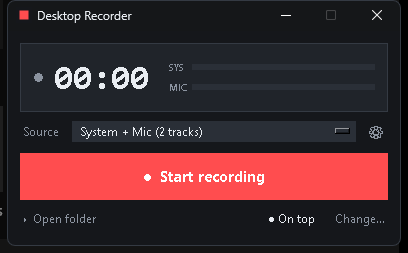
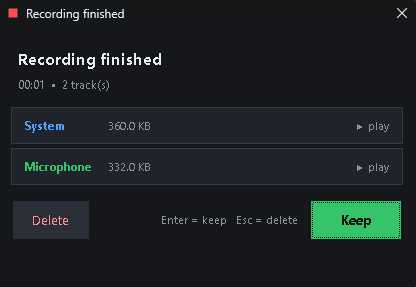

# Desktop Recorder

A tiny Windows recorder that captures **what your speakers are playing** (WASAPI loopback)
and, at the same time, your **microphone on a separate track** — then asks you to
**Keep** or **Delete** each time you stop.





- Start / stop from any app with **Ctrl+Alt+R**
- System audio and mic land in **two separate WAV files** (different sample rates are kept as-is, no resampling)
- Save or throw away the take immediately after stopping (Delete = Recycle Bin, recoverable)
- Live level meters, crash-safe WAV headers, dark always-on-top mini window
- No ffmpeg, no background service, ~1 file of Python

## Run it

Double-click **`Desktop Recorder.vbs`** (no console window), or:

```
pythonw recorder.py
```

A shortcut named **Desktop Recorder** is on your desktop.

If dependencies are missing:

```
python -m pip install -r requirements.txt
```

## Using it

| Action | How |
|---|---|
| Start / stop | `Ctrl+Alt+R` anywhere, or the big button |
| Source | `System + Mic (2 tracks)` · `System audio only` · `Microphone only` |
| Choose devices | ⚙ gear (or right-click → Devices…) |
| Change output folder | `Change…` in the footer |
| Always on top | `● On top` in the footer, or right-click menu |
| Open recordings | `▸ Open folder` |

When you stop, a dialog shows duration and file sizes with **▶ play** next to each track:

- **Keep** (Enter, or close the window) → `.part.wav` is renamed to `.wav`
- **Delete** (Esc) → files go to the **Recycle Bin**

Recordings default to `%USERPROFILE%\Music\Desktop Recordings`:

```
rec_2026-11-09_17-42-03_sys.wav     ← system / desktop audio
rec_2026-11-09_17-42-03_mic.wav     ← microphone
```

Both files start at the same moment; the sources are recorded independently, so
they can be aligned by their start time in any editor (Audacity, Reaper, …).

## Notes & limits

- **WASAPI loopback = Windows 10/11 only.** The recorder taps the *default output*
  device unless you pick another one in Devices… (★ marks the default).
- DRM/protected streams (some streaming services) are muted by the OS at the driver
  level and cannot be captured — that is a Windows limitation, not a bug here.
- If a device is unplugged mid-take, that track stops early; the other keeps going
  and you still get a warning after stopping.
- Files are written as 16-bit PCM WAV at the device's native rate (48 kHz / 44.1 kHz
  are typical) so they open anywhere without conversion.
- Settings live in `%APPDATA%\DesktopRecorder\config.json` (folder, source, devices,
  hotkey string, window position).

## Troubleshooting

**"No system-audio (loopback) device found"** — no WASAPI output device is active.
Play something, or reselect the device in Devices… → Refresh.

**Nothing captured / 0-byte track** — the chosen device is silent or exclusive-mode
locked by another app. Switch the source or close the other app.

**Hotkey unavailable** — another program grabbed `Ctrl+Alt+R`. Edit `"hotkey"` in
`config.json` (same syntax, e.g. `ctrl+shift+r` or `alt+f9`) and restart.

**Start with Windows (optional)** — press `Win+R`, run `shell:startup`, and drop a
shortcut to `Desktop Recorder.vbs` in there.

## Files

```
recorder.py            the app
Desktop Recorder.vbs   launcher without a console
icon.ico               app / shortcut icon
requirements.txt       PyAudioWPatch, numpy
```
